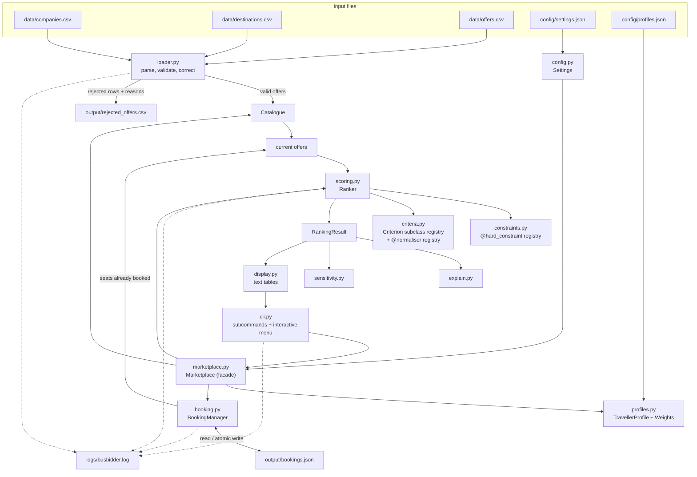
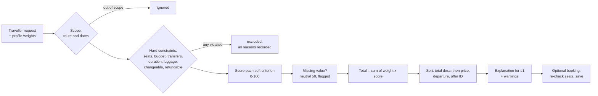

# Architecture

## Components and data flow

## Ranking pipeline

## Responsibilities

| Module | Responsibility | Key classes / functions |
|---|---|---|
| `models.py` | Immutable domain objects | `Company`, `Destination`, `FareConditions`, `Offer`, `Booking` |
| `request.py` | What the traveller asked for | `TravelRequest`, `DepartureWindow` |
| `loader.py` | Read CSVs, validate, correct, quarantine | `load_catalogue`, `Catalogue`, `ValidationReport` |
| `constraints.py` | Hard constraints (pass/fail) | `@hard_constraint`, `apply_hard_constraints`, `FilterResult` |
| `criteria.py` | Soft criteria (0-100 scores) | `Criterion` → `RelativeCriterion` / `AbsoluteCriterion`, `@normaliser` |
| `scoring.py` | Weights and ranking | `Weights`, `Ranker`, `RankingResult` |
| `explain.py` | Generated explanation of the top offer | `explain_recommendation` |
| `sensitivity.py` | Does the winner survive weight changes? | `weight_sensitivity` |
| `profiles.py` | Named traveller profiles from JSON | `TravellerProfile`, `load_profiles` |
| `booking.py` | Simulated bookings and capacity | `BookingManager` |
| `marketplace.py` | Facade that wires the parts together | `Marketplace` |
| `display.py` | Text formatting only | `render_*` functions |
| `cli.py` | Commands and interactive menu | `main`, `InteractiveMenu` |
| `config.py`, `logging_setup.py` | Settings and log file | `Settings`, `load_settings`, `configure_logging` |
